


I'm Alex Blitz, a student developer in Poland. I build front ends in React, TypeScript and Next.js, and APIs in Node.js, Python, Go and PHP. Day to day I work with MySQL, PostgreSQL, SQL Server and Linux.

The part I like best comes after the code ships. I build AI agents and bots that read data, move it, make a decision and report back, so nobody has to do it by hand. Some of my websites are live for real clients. On the side I make trading bots, Flipper Zero apps and an AI video pipeline.

Right now I'm writing a blockchain from scratch in Rust. I'm also learning C++, Kotlin, MongoDB and Redis.


<a href="https://alexblitz.vercel.app/"></a>



The same skyline lives on my [portfolio](https://alexblitz.vercel.app/), where you can orbit it. Here it is a looping SVG, rebuilt from my public contribution calendar.


This README is an agent. A small Python script runs on GitHub Actions every six hours. It reads my public commits and contribution calendar, hashes the commits into a chain with SHA-256, mines each block to three leading zeros, and redraws the panels. The pipeline below is the run that just happened.







<picture>
  <source media="(prefers-color-scheme: dark)" srcset="https://raw.githubusercontent.com/olexpr0/olexpr0/output/snake-dark.svg" />
  <source media="(prefers-color-scheme: light)" srcset="https://raw.githubusercontent.com/olexpr0/olexpr0/output/snake-light.svg" />
  
</picture>


